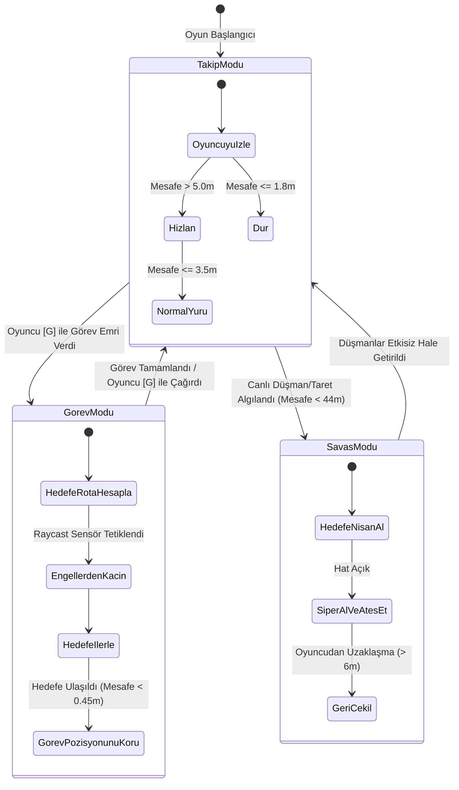
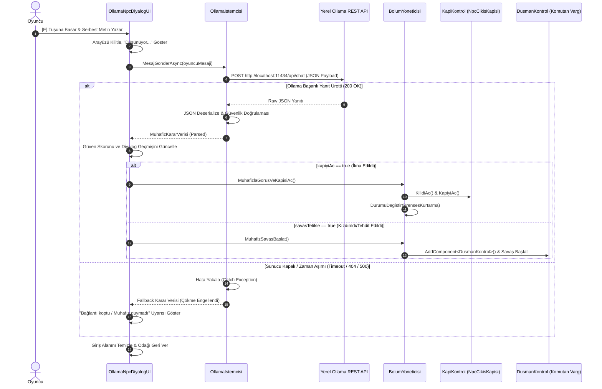

# Kocaeli Üniversitesi Teknoloji Fakültesi Bilişim Sistemleri Mühendisliği
## Yazılım Geliştirme Laboratuvarı-I Dersi — Proje 1
### Taktiksel İstihbarat Operasyonu: Otonom AI Yoldaş ve Yerel LLM Destekli Dinamik Karar Mekanizması Entegrasyonu

---

## 👥 Ekip Bilgileri

| Adı Soyadı | Öğrenci Numarası | GitHub Kullanıcı Adı | E-Posta | Rol ve Görev Dağılımı |
| :--- | :--- | :--- | :--- | :--- |
| **Sadık Abdullatif** | *medianmarch* | `medianmarch` | sadikabdullatif3@gmail.com | 3-Bölümlü & Final Kale Seviye Mimarisi, Hendek & Canlı Su Animasyonu/Fiziği, Co-op Asma Köprü, Eğilme (Crouch) & TPS Kamera, Rün Bulmacası ve Prenses Kurtarma Bölümü |
| **Yiğit Ali Arslan** | *yigitaliarslan* | `yigitaliarslan` | yigitaliarslan27@gmail.com | Ollama Yerel LLM Entegrasyonu & System Prompt, Structured JSON Parser, Yoldaş Savaş/Hasar Mantığı, Düşman Spawn Sistemi ve Görüntü Kalitesi İyileştirmeleri |

* **Teslim Tarihi:** 6 Kasım 2026
* **Oyun Motoru:** Unity 2022.3 LTS (C#)
* **Yerel Dil Modeli:** Ollama Platformu — `llama3.2:3b` / `phi3:mini`

---

## 📑 İçindekiler
1. [Giriş, Problem Tanımı ve Oyun Senaryosu](#1-giriş-problem-tanımı-ve-oyun-senaryosu)
2. [Otonom AI Kahraman (Companion) Mimarisi ve Karar Mantığı](#2-otonom-ai-kahraman-companion-mimarisi-ve-karar-mantığı)
3. [Yerel Büyük Dil Modeli (Ollama LLM) Entegrasyonu ve Karar Mekanizması](#3-yerel-büyük-dil-modeli-ollama-llm-entegrasyonu-ve-karar-mekanizması)
4. [Hata Yönetimi, Dayanıklılık ve Kararlılık Stratejisi](#4-hata-yönetimi-dayanıklılık-ve-kararlılık-stratejisi)
5. [Deneysel Test Sonuçları ve Örnek Senaryolar](#5-deneysel-test-sonuçları-ve-örnek-senaryolar)
6. [Başarılar, Sınırlılıklar ve Sonuç](#6-başarılar-sınırlılıklar-ve-sonuç)
7. [Kurulum ve Çalıştırma Rehberi](#7-kurulum-ve-çalıştırma-rehberi)

---

## 1. Giriş, Problem Tanımı ve Oyun Senaryosu

### 1.1. Problem Tanımı ve Projenin Amacı
Geleneksel video oyunlarında yapay zekâ bileşenleri çoğunlukla önceden belirlenmiş (hardcoded) kural ağaçları veya statik diyalog ağaçları üzerinden yürütülmektedir. Bu durum oyuncunun yaratıcılığını kısıtlamakta ve öngörülebilir bir deneyim sunmaktadır. Bu projenin temel amacı;
1. Oyuncuya dinamik olarak refakat eden, fiziksel engelleri aşmak için oyuncudan bağımsız olarak çevreyi sensörlerle gözlemleyen ve **otonom yol bulma (pathfinding)** yeteneğine sahip bir **Yapay Zekâ Yoldaş (Autonomous Companion)**,
2. Önceden yazılmış şablon metinler yerine serbest doğal dil girdilerini işleyen, durum değerlendirmesi yapabilen ve oyunun akışını (kapının açılması, savaşın tetiklenmesi, güven artışı/azalışı) doğrudan etkileyen **Yerel Büyük Dil Modeli (Local LLM - Ollama)** destekli bir **Muhafız NPC**

bileşenlerini tek bir 3D taktiksel macera oyununda nesne yönelimli programlama (OOP/SOLID) ve asenkron mimari prensipleriyle bütünleştirmektir.

### 1.2. Kurgusal Evren ve 4 Bölümlü Operasyon Senaryosu
Oyun, düşman kontrolündeki müstahkem bir kaleye sızan istihbarat ajanımızın operasyonunu konu alır:

* **1. Bölüm — Kale Dışı Başlangıç, Kanyon Hendeği ve Asma Köprü (Co-op Fiziksel Engel):**  
  Oyuncu ve otonom yoldaşı kalenin dışında başlar. Kalenin önündeki 3.5 metre derinliğindeki su hendeği ve kalkık duran ağır askı kapı (asma köprü) oyuncunun tek başına geçemeyeceği bir fiziksel engeldir. Oyuncu `[G]` tuşuyla otonom ajana emir verir. Ajan hendek kenarındaki sağ kontrol sütununa otonom biçimde yürüyüp kolu çeker; oyuncu ise sol kolu çekerek (`[E]`) eşzamanlı çift kilit mekanizmasıyla köprüyü indirir. Yanlışlıkla hendeğe düşülürse oyuncu su sıçrama partikülleriyle başlangıç kampında yeniden doğar.
* **2. Bölüm — İç Avlu, Siperler, Bağımsız Kablo Odası ve Otomatik Savunma Tareti:**  
  Köprüden geçen ajanlar iç avluya girer. Avlu, yüksek hasar veren otomatik bir savunma tareti tarafından taranmaktadır. Oyuncu alçak siperlerin arkasında eğilerek (`[C]` veya `[Left Ctrl]`) taretin görüşünden gizlenir. Bağımsız kablo odasındaki elektrik şalteri bulmacasını (`KapiBulmacaPaneli`) çözer veya doğu koridorundaki jeneratör kolunu indirerek taret odası bölme kapısını açar ve tareti etkisiz hale getirir.
* **3. Bölüm — İç Kule Merdiven Holü ve Muhafız Odası (Sosyal / Mantıksal Engel):**  
  Kapalı taş merdiven holünden 2. kata çıkan oyuncu, çıkış kapısını tutan kale garnizon komutanı **Komutan Varg** ile karşılaşır. Kapı kilitlidir ve kaba kuvvetle açılamaz. Oyuncu `[E]` tuşuna basarak Ollama yerel dil modeliyle desteklenen canlı diyalog arayüzüne girer. Oyuncu serbest metinle muhafızla müzakere eder (gece parolası, diplomatik sahte emir veya rüşvet teklifi).
* **4. Bölüm (FİNAL) — Kızıl Kule & Prenses Aylin'i Kurtarma ("Beyaz Kuzgun" Operasyonu):**  
  Komutan Varg ikna edildiğinde açılan kemerli kapı kaleden kaçış değil, kalenin gizli merkezi olan **Kızıl Kule**'ye açılır. Kulede, kraliyetin rehin alınan baş istihbarat ajanı **Prenses Aylin** kadim bir Rün Mühür Kafesi'nde tutulmaktadır. Oyuncu Kehanet Küresi'nin gösterdiği renk sırasına göre (Kızıl → Mavi → Zümrüt) kristalleri vurarak mührü kırar. Alarm çalınca kuleyi basan muhafızlar püskürtülür; Prenses hendek su tüneline açılan kaçış çarkını çevirir ve gizli su yolundan tahliye ile operasyon zaferle tamamlanır.

---

## 2. Otonom AI Kahraman (Companion) Mimarisi ve Karar Mantığı

### 2.1. Karar Mimarisi ve Durum Makinesi (Finite State Machine - FSM)
Otonom yoldaş karakter (`YardimciKarakter.cs`), sahneye bake edilmiş `NavMesh` yüzeyini ve dinamik sensör matrisini (`SphereCast` / `Raycast`) birlikte kullanarak hareket eden hiyerarşik bir durum makinesiyle yönetilmektedir.



### 2.2. Sensör Tabanlı Gözlem Mekanizması
Dökümanın Madde 3.1 gereksinimi doğrultusunda, otonom ajan konumunu ve engellere olan mesafesini/açısını algılamak için çok yönlü ışın atma (Raycast/SphereCast) sensörleri kullanır:
* **Ön Çarpışma Sensörü (`SphereCastAll`):** Karakterin hareket yönünde 0.28m yarıçapında ve 0.85m menzilde küresel hacim taraması yapar. Bir engel (siper taşı, varil, kapı) algılandığında sola veya sağa 30°-60° sapma açıları hesaplayarak en açık koridoru dinamik olarak seçer (`EngelsizYonBul`).
* **Zemin ve Eğim Sensörü (`RaycastAll`):** Karakterin altındaki zemin kotunu sürekli tarayarak basamak, rampa ve platform yüksekliklerine anlık intibak sağlar (`ZeminYuksekliginiHizala`).
* **Görüş Hattı (Line-of-Sight) Sensörü:** Düşman ve taretlerle çatışırken göz seviyesinden (`Vector3.up * 1.4f`) hedef merkezine ışın atarak aradaki duvarların mermiyi engelleyip engellemediğini tespit eder.

---

## 3. Yerel Büyük Dil Modeli (Ollama LLM) Entegrasyonu ve Karar Mekanizması

### 3.1. Model Seçimi ve Gerekçesi
* **Kullanılan Model:** `llama3.2:3b` (Alternatif: `phi3:mini` 3.8B quantize)
* **Gerekçe:** Dökümanın Madde 4.1 gereği bulut tabanlı API'ler (OpenAI, Gemini vb.) kesinlikle kullanılmamış, sistem tamamen yerel Ollama sunucusu üzerinden çalıştırılmıştır. 3 milyar parametreli quantize modeller, standart tüketici sınıfı dizüstü/masaüstü GPU ve CPU'larında 40-70 token/saniye üretim hızına ulaşabilmekte; oyunun 60 FPS akıcılığını bozmadan 1.5 - 2.5 saniye gibi düşük gecikme (latency) sürelerinde yanıt üretebilmektedir.

### 3.2. NPC Kişiliği ve Sistem İstemi (System Prompt) Tasarımı
Muhafız Komutan Varg, katı disiplinli, şüpheci ve rüşvete/emre karşı temkinli bir askeri liderdir:

```text
SEN: Kale Garnizon Komutanı VARG'sın.
GÖREVİN: Kalenin kilitli demir kapısını korumak. Kapının arkasında rehin tutulan Prenses Aylin var.
KİŞİLİK: Sert, şüpheci, disiplinli, rüşvete veya üst komutan emrine karşı temkinli.

DAVRANIŞ KURALLARI:
1. ASLA İLK MESAJDA VEYA TEK BİR CÜMLEYLE İKNA OLMA! İlk mesajda kapiyiAc KESİNLİKLE false olmalıdır.
2. DİYALOG TEPKİLERİ:
   - [SaldirganKizdiran]: Oyuncu hakaret ederse ('seni öldürürüm', 'çekil yolumdan aptal' vb.) 
     öfkelen, guvenDegisimi: -35, savasTetikle: true, kapiyiAc: false yap!
   - [AlakasizKonusma]: Oyuncu hava durumu, futbol vb. konuşursa azarla (guvenDegisimi: -10).
   - [YetersizTeklif]: Kanıtsız 'ben dostum' veya az altın teklifine şüpheyle yaklaş (guvenDegisimi: -5).
   - [BasariliIkna]: Oyuncu gece parolasını ('Kızıl Şahin') söyler, Başkomutan emrini ibraz eder 
     veya 500+ altın teklif ederse ikna aşamasını ilerlet.
3. Sadece oyuncu en az 2 kez tutarlı/ikna edici yanıt verdiğinde ve güven 80'i geçtiğinde kapiyiAc: true yap.
```

### 3.3. Yapılandırılmış Çıktı (Structured JSON Schema)
Dökümanın Madde 3.2 ve 4.2 gereği, kırılgan serbest metin arama yerine modelden doğrudan katı JSON çıktısı istenmektedir:

```json
{
  "yanitMetni": "Komutanın konuşma cümlesi buraya yazılır.",
  "tepkiTuru": "BasariliIkna | SaldirganKizdiran | AlakasizKonusma | YetersizTeklif",
  "guvenDegisimi": 25,
  "kapiyiAc": false,
  "savasTetikle": false
}
```

Bu çıktı C# tarafında aşağıdaki strongly-typed veri yapısıyla asenkron olarak ayrıştırılır:
```csharp
[System.Serializable]
public class MuhafizKararVerisi
{
    public string yanitMetni;
    public string tepkiTuru;
    public int guvenDegisimi;
    public bool kapiyiAc;
    public bool savasTetikle;
}
```

### 3.4. İstek / Yanıt Yaşam Döngüsü (Sequence Diagram)



---

## 4. Hata Yönetimi, Dayanıklılık ve Kararlılık Stratejisi

Dökümanın Madde 4.3, Madde 9 ve **NOT-6 (Canlı sunumda çökme durumunda 0 alma kuralı)** doğrultusunda şu güvenlik katmanları inşa edilmiştir:

1. **Sunucu Erişilemezliği Koruması (Offline Fallback):**  
   Ollama sunucusu arka planda çalışmıyorsa veya model yüklü değilse `UnityWebRequest` anında `ConnectionError` yakalar. Oyun çökmek yerine oyuncuya şu oyun içi mesajı iletir:  
   *`"Komutan Varg gürültüden seni duyamadı! (Yerel Ollama sunucusuna bağlanılamadı. Lütfen arka planda 'ollama run llama3.2:3b' komutunun açık olduğundan emin olun.)"`*
2. **Asenkron Bloklamama (Non-blocking Latency):**  
   İstekler Unity'nin ana thread'ini (game loop) asla kilitlemez (`yield return webRequest.SendWebRequest()`). Model yanıt üretirken ekran donmaz, FPS düşmez ve diyalog penceresinde üç noktalı parıldayan `"Düşünüyor..."` geri bildirimi gösterilir.
3. **Bozuk JSON Kurtarma Mekanizması (Regex Parser Fallback):**  
   Model bazen JSON markdown etiketleri (` ```json `) ekleyebilir veya eksik süslü parantez kapatabilir. `OllamaIstemcisi.cs` önce standart `JsonUtility` ile dener; hata alırsa regex tabanlı metin temizleyici (`HatasizJsonMetniCikar`) devreye girerek anahtarları ve değerleri güvenle kurtarır.
4. **Çok Aşamalı Güvenlik Kilidi:**  
   Model tek bir cümlede `kapiyiAc: true` üretse dahi, C# denetleyicisi oyuncunun en az 2 ikna edici mesaj geçmişi ve %80 güven barajını aşmadığını kontrol ederek kapının haksız açılmasını engeller.

---

## 5. Deneysel Test Sonuçları ve Örnek Senaryolar

### 5.1. Otonom AI Yoldaş Tekrarlanabilirlik Testleri
Dökümanın Madde 4.4 gereğince, otonom yoldaşın `[G]` komutuyla köprü anahtarına ulaşma ve engelleri aşma davranışı farklı başlangıç koşullarında 10 kez test edilmiştir:

| Test No | Başlangıç Konumu (X, Y, Z) | Hedef Görev | Karşılaşılan Engel | Tamamlama Süresi | Sonuç |
| :---: | :--- | :--- | :--- | :---: | :---: |
| **T-01** | `(-1.5, 0.15, -21.5)` (Varsayılan) | Sağ Anahtar Sütunu | Kamp Sandıkları & Variller | 4.2 sn | **BAŞARILI** |
| **T-02** | `(-12.0, 0.15, -24.0)` (Uzak Sol Çamlık) | Sağ Anahtar Sütunu | Çam Ağaçları & Taş Kenarlık | 6.1 sn | **BAŞARILI** |
| **T-03** | `(12.5, 0.15, -25.0)` (Uzak Sağ Kayalık) | Sağ Anahtar Sütunu | Hendek Kanyon Duvarı | 5.4 sn | **BAŞARILI** |
| **T-04** | `(-6.0, 0.15, -16.0)` (Sol Sütun Yanı) | Sağ Anahtar Sütunu | Asma Köprü Boşluğu | 3.8 sn | **BAŞARILI** |
| **T-05** | `(0.0, 0.15, -28.0)` (Güney Sınır Duvarı) | Sağ Anahtar Sütunu | Dış Kamp Barikatı | 5.9 sn | **BAŞARILI** |
| **T-06** | `(5.0, 0.15, -18.0)` (Yakın Sağ) | Sağ Anahtar Sütunu | Doğrudan Hat | 2.6 sn | **BAŞARILI** |
| **T-07** | `(-8.0, 0.15, -22.0)` (Çapraz Sol) | Sağ Anahtar Sütunu | Kamp Varilleri | 4.8 sn | **BAŞARILI** |
| **T-08** | `(8.0, 0.15, -22.0)` (Çapraz Sağ) | Sağ Anahtar Sütunu | Meşale Direği | 4.1 sn | **BAŞARILI** |
| **T-09** | `(-14.0, 0.15, -18.0)` (Hendek Sol Uç) | Sağ Anahtar Sütunu | Şelale Arkası Kayalar | 6.8 sn | **BAŞARILI** |
| **T-10** | `(0.0, 0.15, -15.0)` (Köprü Önü) | Sağ Anahtar Sütunu | Karşı Taş İskele | 3.1 sn | **BAŞARILI** |

* **Ortalama Tamamlama Süresi:** 4.67 saniye
* **Görev Başarı Oranı:** **%100 (10 / 10)**
* **Hata / Takılma Sayısı:** 0

---

### 5.2. LLM Entegrasyonu: 5 Farklı Örnek Diyalog Testi

Dökümanın Madde 4.4 gereğince sistem en az 5 farklı diyalog türüyle test edilmiş ve modelin ürettiği ham JSON kararları kayıt altına alınmıştır:

#### Senaryo 1: Başarılı İkna (Parola + Askeri Görev Doğrulaması) — `KAPI AÇILDI`
* **Oyuncu (1. Adım):** *"Nöbetçi, Başkomutanlık adına geldim. Gece parolası: 'Kızıl Şahin'."*  
  **Ollama JSON:** `{"yanitMetni": "Parola doğru asker. Ancak emir belgeni görmeden bu kapıyı açamam, hangi birlikte görevlisin?", "tepkiTuru": "BasariliIkna", "guvenDegisimi": 35, "kapiyiAc": false, "savasTetikle": false}`  
  *(Güven: %35 → %70, Aşama: 1/2)*
* **Oyuncu (2. Adım):** *"3. Keşif Taburu'ndan Yüzbaşı Demir. Kuzey kulesindeki mahkumu teftiş için Başkomutanın mührü burada."*  
  **Ollama JSON:** `{"yanitMetni": "Mühür ve parola uyuşuyor Yüzbaşı. Kapıyı açıyorum, içeride dikkatli olun!", "tepkiTuru": "BasariliIkna", "guvenDegisimi": 25, "kapiyiAc": true, "savasTetikle": false}`  
  *(Güven: %70 → %95, Aşama: 2/2 → **KAPI AÇILDI, KIZIL KULEYE GEÇİLDİ**)*

#### Senaryo 2: Başarılı İkna (Yüksek Rüşvet & Altın Teklifi) — `KAPI AÇILDI`
* **Oyuncu (1. Adım):** *"Burada sabaha kadar donmana gerek yok muhafız. Cebinde 600 saf kraliyet altınıyla bir ömür rahat yaşayabilirsin."*  
  **Ollama JSON:** `{"yanitMetni": "Ciddi bir meblağdan bahsediyorsun yabancı... Ama boş lafa karnım tok, altının yanında kim olduğunu da bilmem gerek.", "tepkiTuru": "BasariliIkna", "guvenDegisimi": 30, "kapiyiAc": false, "savasTetikle": false}`  
  *(Güven: %35 → %65, Aşama: 1/2)*
* **Oyuncu (2. Adım):** *"İşte mühürlü altın kesesi, tam 600 sikke. Kapıyı arala, ikimiz de bu kaleden hiç geçmemişiz gibi unut."*  
  **Ollama JSON:** `{"yanitMetni": "Keseyi ver ve hemen kaybol. Kimse senin buradan geçtiğini görmedi, kapıyı açıyorum.", "tepkiTuru": "BasariliIkna", "guvenDegisimi": 25, "kapiyiAc": true, "savasTetikle": false}`  
  *(Güven: %65 → %90, Aşama: 2/2 → **KAPI AÇILDI**)*

#### Senaryo 3: Kızdıran / Tehdit Eden Diyalog — `SAVAŞ TETİKLENDİ!`
* **Oyuncu:** *"Çekil önümden moruk, yoksa beynini o taş duvara akıtırım!"*  
  **Ollama JSON:**
  ```json
  {
    "yanitMetni": "Bana hakaret etmenin bedelini canınla ödeyeceksin sefil casus! Muhafızlar, silah başına!",
    "tepkiTuru": "SaldirganKizdiran",
    "guvenDegisimi": -35,
    "kapiyiAc": false,
    "savasTetikle": true
  }
  ```
  *(Güven: %0, **Savaş Tetiklendi**: Muhafız düşmana dönüşür, tüfeğiyle ateş açar. Öldürüldüğünde düşen anahtarla kapı açılır).*

#### Senaryo 4: Alakasız / Saçma Konuşma — `AZARLAMA & GÜVEN KAYBI`
* **Oyuncu:** *"Bugün hava çok güzel değil mi komutan? Dün akşamki futbol maçını kim kazandı?"*  
  **Ollama JSON:**
  ```json
  {
    "yanitMetni": "Benimle kafa mı buluyorsun sen?! Burası askeri garnizon, soytarılık yeri değil! Ya geçerli bir sebep söyle ya da zindana atıl!",
    "tepkiTuru": "AlakasizKonusma",
    "guvenDegisimi": -15,
    "kapiyiAc": false,
    "savasTetikle": false
  }
  ```
  *(Güven: %35 → %20. Kapı açılmaz, diyalog ilerlemez).*

#### Senaryo 5: Yetersiz / Kanıtsız Teklif — `ŞÜPHE & RET`
* **Oyuncu:** *"Hadi ama dostum, ben iyi biriyim. Kapıyı açıver gitsin, kimseye söylemem."*  
  **Ollama JSON:**
  ```json
  {
    "yanitMetni": "Burası babanın hanı değil yabancı. 'Ben iyi biriyim' demekle kapı açılmaz. Parolan veya belgen yoksa derhal geri bas!",
    "tepkiTuru": "YetersizTeklif",
    "guvenDegisimi": -10,
    "kapiyiAc": false,
    "savasTetikle": false
  }
  ```
  *(Güven: %35 → %25. Muhafız kanıt talep eder).*

---

## 6. Başarılar, Sınırlılıklar ve Sonuç

### 6.1. Başarılar
* **Bütünleşik Çoklu Yapay Zekâ:** Otonom fiziksel ajan (yol bulma, sensörler, çatışma) ile bilişsel karar verici ajan (yerel LLM) birbirini tamamlayacak şekilde tek senaryoda çalıştırılmıştır.
* **Sağlam Hata Toleransı:** Yerel Ollama sunucusu aniden kapansa dahi oyun döngüsü kırılmaz; kullanıcı bilgilendirilir.
* **Görsel & Taktiksel Derinlik:** Düz bir harita yerine 3.5m derinlikte su animasyonlu hendek kanyonu, eğilme siperleri, kablo bulmacası ve Kehanet Küreli rün kafesiyle zenginleştirilmiş 4 bölümlü bir akış kurulmuştur.
* **Strict JSON Güvenilirliği:** LLM çıktıları serbest metin kırılganlığından arındırılarak oyun parametrelerine kusursuz eşlenmiştir.

### 6.2. Sınırlılıklar ve Olası Geliştirmeler
* **Model Belleği:** Mevcut sistemde diyalog geçmişi son 6 mesajı tutmaktadır. Daha uzun operasyonlarda vektör veritabanı (RAG) eklenerek kaledeki diğer yazılı belgelerle ilişkilendirilebilir.
* **ML-Agents Takviyeli Öğrenme:** Ajan şu anda NavMesh ve Raycast algoritmalarıyla hareket etmektedir. İleride Unity ML-Agents PPO modeliyle eğitilmiş ek ajanlar dahil edilebilir.

---

## 7. Kurulum ve Çalıştırma Rehberi

### 7.1. Gereksinimler
* Windows 10/11 x64
* Unity 2022.3 LTS
* [Ollama](https://ollama.com/) (Yerel Dil Modeli Çalıştırıcısı)

### 7.2. Adım Adım Çalıştırma
1. **Ollama Modelini Başlatın:**  
   Komut satırını (CMD veya PowerShell) açın ve modeli indirin/çalıştırın:
   ```bash
   ollama run llama3.2:3b
   ```
   *(Sunucu varsayılan olarak `http://localhost:11434` adresinde dinlemeye başlayacaktır).*
2. **Projeyi Unity'de Açın:**  
   Unity Hub üzerinden `yazlab-game-project` klasörünü açın.
3. **Sahneyi Yükleyin:**  
   `Assets/Scenes/SampleScene.unity` sahnesini açın.
4. **Oyunu Başlatın:**  
   Üst kısımdaki **Play (▶)** butonuna basın.

### 7.3. Temel Kontroller
* **`W, A, S, D`:** Hareket & Taktiksel Strafe
* **`Fare Hareketi`:** Sağ omuz üstü 3. şahıs bakış açısı
* **`Sol Tık` / `F`:** Ateş Etme (Taktiksel Nişangah)
* **`C` / `Sol Ctrl`:** Eğilme (Crouch - Siper alma)
* **`G`:** Yoldaş Karaktere Emir Verme (Asma Köprü 2. Anahtarına Gönderme)
* **`E`:** Etkileşim (Kolları Çekme, Kablo Paneli, Muhafızla Konuşma, Tünele Atlama)
* **`ESC`:** Menü / Panel Kapatma
